# SIMBIA

**Simbiosis hídrica industrial para el Reto Cabot.** SIMBIA encuentra a las empresas
vecinas de la planta de Cabot en Mamonal (Cartagena), lee sus permisos de vertimiento
y simula en un gemelo digital de la torre de enfriamiento cuánta agua cruda se deja
de captar al reutilizar las aguas de rechazo de esas empresas.

<p align="center">
  <a href="https://simbia.sentralabs.co"><strong>▶ Ver SIMBIA en vivo</strong></a>
</p>

<p align="center">
  <a href="https://simbia.sentralabs.co">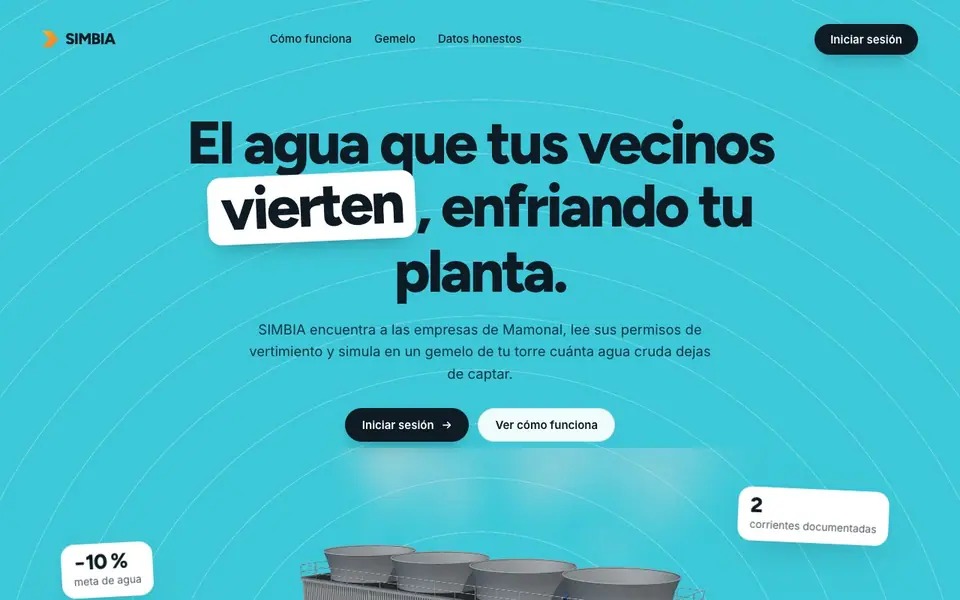</a>
</p>

## El reto

> «Reducir al menos un 10 % el consumo de agua en la planta, reutilizando las aguas
> de rechazo de empresas vecinas para los sistemas de enfriamiento.»
>
> — Enunciado del Reto Cabot

SIMBIA decide **de qué vecino tomar agua, con qué tratamiento, en qué proporción, con
cuánto ácido y a qué ciclos de concentración operar la torre**, todo a la vez, porque
son decisiones acopladas. Sobre esa base añade tres modelos de IA que anticipan la
demanda, detectan fugas y avisan del ensuciamiento antes de que ocurra.

| Escenario | Reducción del consumo | Inversión | Retorno |
|---|---|---|---|
| **Meta del reto**, al menor costo | 10 % | 73 k USD | 5 meses |
| **Caso base**, con vecinos tipo | 38,8 % | 532 k USD | 1,15 años |
| **Catálogo real** de Mamonal | 38 % | 476 k USD | — |
| **Mexichem + Yara**, con sus documentos | 33 % | 605 k USD | 1,87 años |

La línea base de la planta parte de supuestos, así que estas cifras orientan la
decisión pero **ninguna es un ahorro validado**. En
[Honestidad sobre los datos](#honestidad-sobre-los-datos) está qué falta para validarlas.

## Capturas

| | |
|---|---|
| 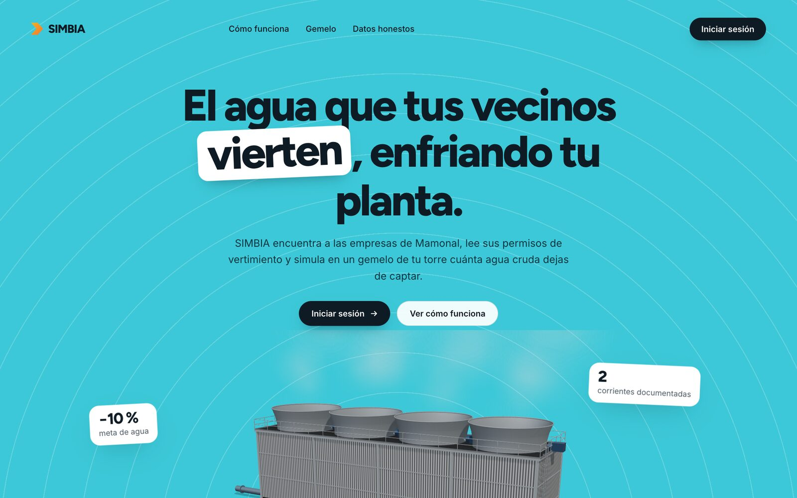 | 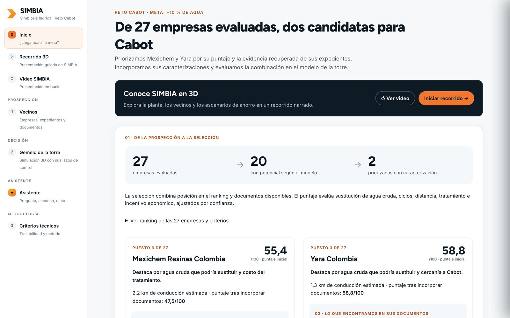 |
| **Portada:** el proyecto, con la torre 3D en vivo | **Inicio:** de 27 empresas evaluadas a dos candidatas con evidencia |
| 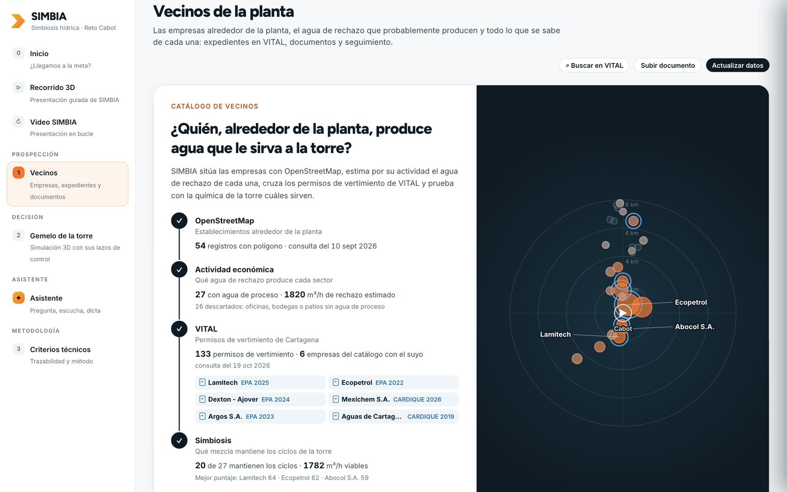 | 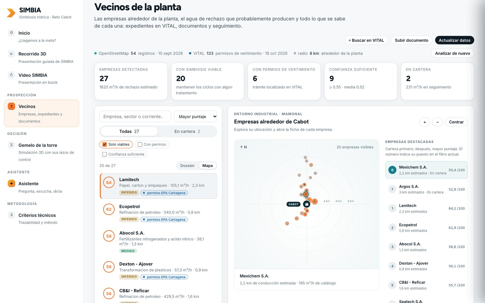 |
| **Analizar empresas:** el catálogo se arma a la vista en cuatro etapas | **Mapa de proximidad:** quién está cerca, con la distancia de conducción |
| 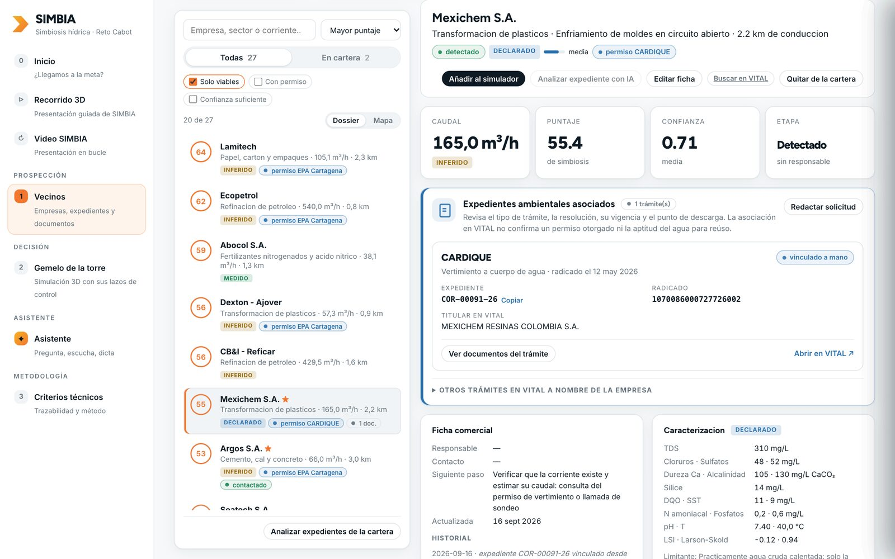 | 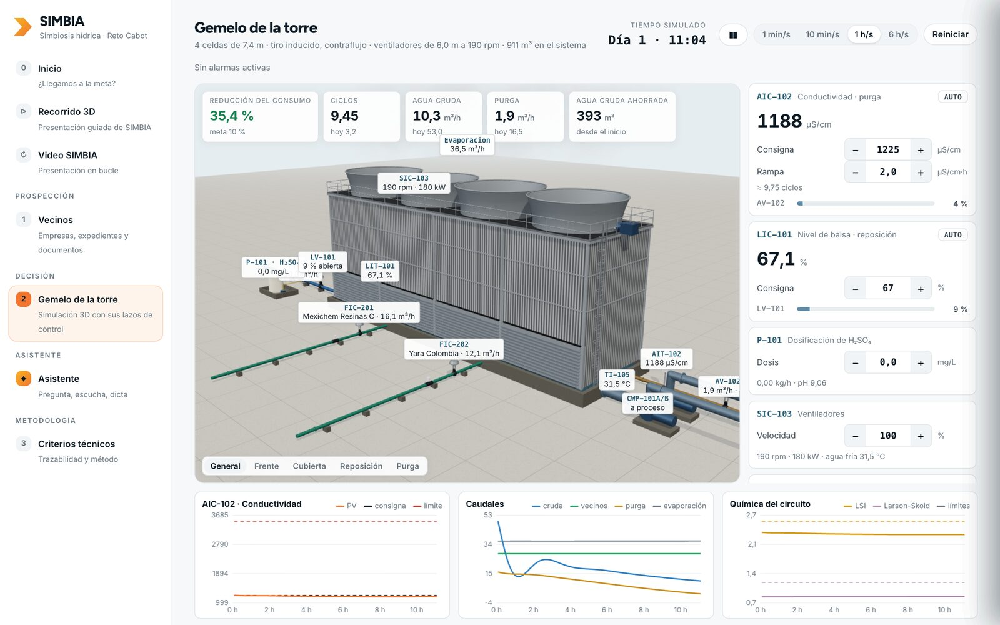 |
| **Dossier:** expediente ambiental, ficha y caracterización de cada empresa | **Gemelo de la torre:** Mexichem y Yara entrando al circuito, con sus lazos de control |
| 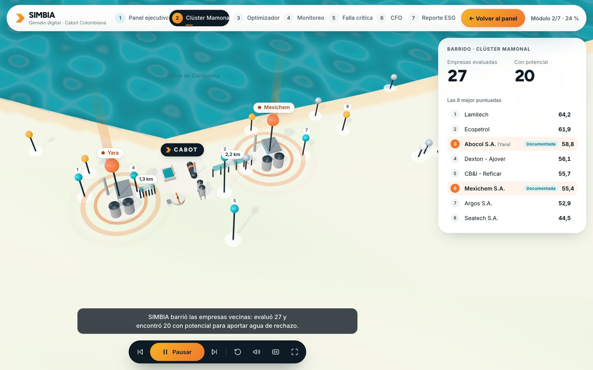 | 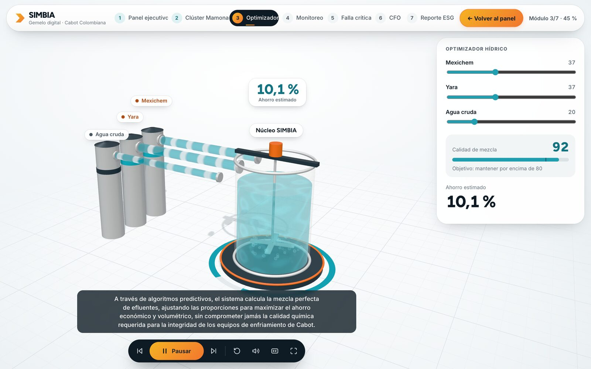 |
| **Recorrido 3D:** las empresas del clúster de Mamonal, a escala | **Recorrido 3D:** la mezcla de vecinos y su calidad |
| 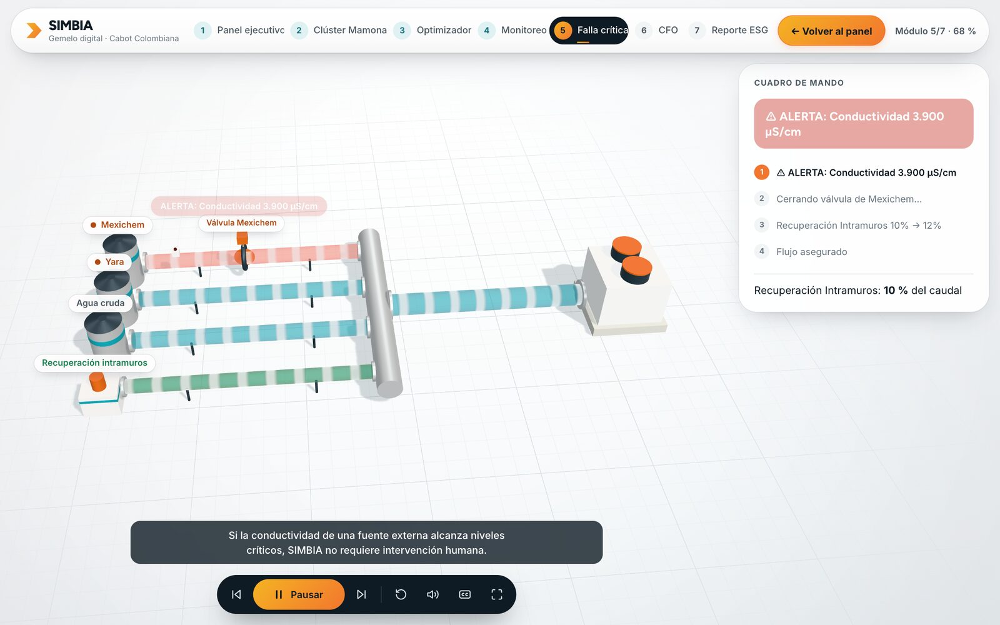 | 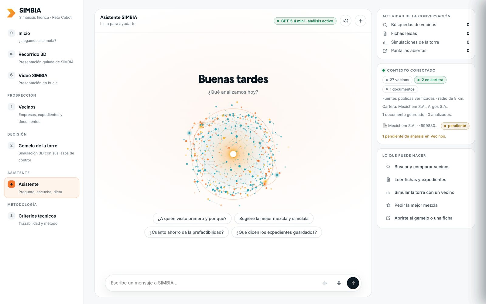 |
| **Falla crítica:** qué hace la planta si una fuente se sale de rango | **Asistente:** se le escribe o se le habla, y actúa sobre la plataforma |
| 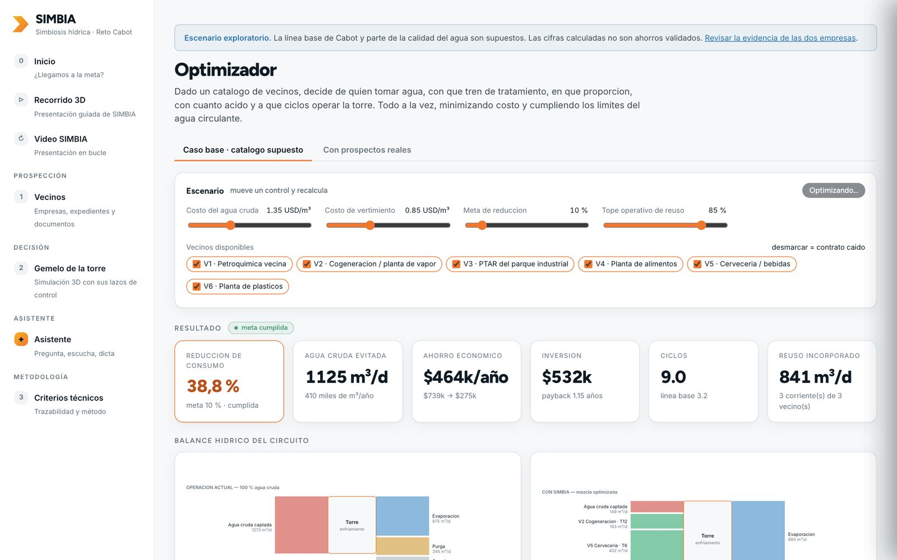 | 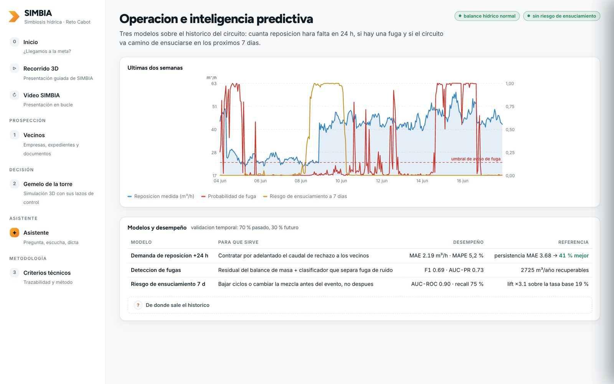 |
| **Optimizador:** mezcla, tratamiento y ciclos a la vez | **Operación e IA:** demanda, fugas y ensuciamiento |

## La idea que hace falta entender

En una torre de enfriamiento abierta:

```
M = E · N / (N − 1)
```

- **E (evaporación)** la fija la carga térmica. **No se puede reducir.** Es agua perdida sí o sí.
- Lo único recortable es la **purga**, y eso depende de **N**, los ciclos de concentración.
- **N lo limita la calidad del agua de aporte**: cuanto más salina, antes se alcanzan
  los límites de incrustación, corrosión y ensuciamiento.

De ahí la trampa del reto: **meter agua de rechazo sin optimizar baja los ciclos
alcanzables y puede aumentar la captación total de agua cruda.** Reutilizar no es
gratis; hay que resolver mezcla, tratamiento, acidificación y ciclos simultáneamente.
Eso es exactamente lo que hace el optimizador.

## La plataforma: un módulo por pregunta

| Módulo | Pregunta que responde |
|---|---|
| **Inicio** (`#inicio`) | ¿Llegamos a la meta? Resume el barrido (27 empresas evaluadas, 20 con potencial, 2 priorizadas), compara la química documentada de Mexichem y Yara, sitúa las dos corrientes a escala y carga su combinación en el gemelo. |
| **Vecinos** (`#prospeccion`) | ¿Quiénes son los vecinos, qué agua producen y qué se sabe de cada uno? Empieza con **Analizar empresas**: el catálogo se arma a la vista en cuatro etapas (OpenStreetMap, actividad económica, VITAL y simbiosis) sobre un radar alrededor de la planta. Después, lista y mapa con buscador y filtros, y el dossier de cada empresa: sus expedientes, caracterización, documentos, lectura con IA y ficha comercial. Desde la cabecera se abren el **Buscador VITAL** y **Fuentes y documentos**. |
| **Gemelo de la torre** (`#simulador`) | ¿Qué le pasa a mi torre, hora a hora, si acepto el agua de estos vecinos? Torre 3D a escala, simulación dinámica con los lazos de una planta real (nivel, conductividad, caudal de cada vecino, ácido, ventiladores), alarmas y tendencias. La mezcla de partida la propone el optimizador. |
| **Asistente** (`#asistente`) | Se le escribe o se le dicta, y además actúa: busca vecinos, lee fichas, simula la torre, pide la mezcla al optimizador y abre el gemelo o una ficha. Cada herramienta que usa se ve en el chat como un paso. Con el modo conversación responde en voz alta, vuelve a escuchar y se le puede interrumpir. |
| **Criterios técnicos** (`#modelo`) | ¿Qué da por supuesto la aplicación y cómo calcula cada cosa? |
| **Recorrido 3D** (`/demo3d.html`) | La presentación guiada por voz en siete módulos: panel ejecutivo, clúster de Mamonal, optimizador, monitoreo, falla crítica, CFO y reporte ESG. |
| **Video SIMBIA** (`/video.html`) | La presentación en bucle, para pantallas y ferias. |

Fuera del menú, pero accesibles por su enlace: **Embudo comercial** (`#embudo`),
**Optimizador** (`#optimizador`) y **Operación e IA** (`#operacion`).

La prospección alimenta al optimizador: las empresas que encuentra el barrido entran
al mismo optimizador, con la misma química y las mismas restricciones. Lo único que
cambia es de dónde salió el catálogo, y la confianza de cada dato viaja con él,
traducida a factor de disponibilidad anual.

## Puesta en marcha

Requiere **Python 3.12 o superior**. Las versiones anteriores no instalan las
dependencias fijadas; compruébalo con `python3 --version`.

```bash
python3 -m venv .venv
./.venv/bin/pip install -r backend/requirements.txt
./.venv/bin/python -m uvicorn simbia.main:app --app-dir backend --port 8123
```

Portada en `http://localhost:8123`, panel en `http://localhost:8123/app` y API
documentada en `http://localhost:8123/docs`. Los modelos de IA predictiva se entrenan
solos la primera vez.

**Funciona sin configurar nada.** El repositorio trae la caché de datos públicos, así
que la prospección arranca con las 27 empresas y sin salir a la red. Sin usuarios
definidos el panel queda abierto, como corresponde a una instalación local.

| Variable | Para qué sirve |
|---|---|
| `OPENAI_API_KEY` | Activa el asistente, la voz y la lectura de PDF. `ANTHROPIC_API_KEY` es la alternativa para texto y PDF; la voz solo funciona con OpenAI. Sin clave, lo demás sigue funcionando |
| `SIMBIA_SCOUT_MODO` | `offline` (por defecto), `cache` o `vivo`. El Buscador VITAL y **Actualizar datos** necesitan conexión para las consultas nuevas |
| `SIMBIA_AUTH_USUARIO`, `SIMBIA_AUTH_HASH`, `SIMBIA_AUTH_SECRETO` | Activan el acceso con usuario y contraseña |

Pruebas (305, sin red):

```bash
cd backend && ../.venv/bin/python -m pytest
```

El despliegue en servidor está en [`deploy/README.md`](deploy/README.md).

## Qué hace cada pieza

### 1. Gemelo digital químico (`domain/`)

No es una hoja de cálculo con reglas de tres. Resuelve el **equilibrio carbonatado**
real: al mezclar dos aguas no se promedia el pH, se mezclan alcalinidad y carbono
inorgánico total y se resuelve el equilibrio. Y el agua circulante se evalúa **en
equilibrio con el CO₂ atmosférico**, porque una torre airea intensamente y eso sube
el pH varias décimas; ignorarlo es el error más común al estimar la incrustación.

### 2. Optimizador (`optim/blend.py`)

El problema es no lineal (los ciclos multiplican a las concentraciones; el LSI depende
del producto Ca × alcalinidad). Se resuelve como:

1. Barrido exterior sobre **N** discreto. Fijado N, la demanda M es constante.
2. Para cada N, un **LP (HiGHS)** sobre caudales y dosis de ácido: los límites por
   parámetro son lineales porque la concentración en el circuito es exactamente N veces
   la del aporte.
3. Las dos restricciones bilineales (LSI y producto CaSO₄) por **linealización sucesiva**.
4. La temperatura de la mezcla cambia la evaporación, así que M se resuelve por
   **punto fijo** dentro del mismo bucle.
5. **Toda solución se verifica con el modelo químico completo y no lineal.** Si falla,
   se aprieta un factor de seguridad y se repite. Nunca se reporta como factible una
   solución que el modelo real rechaza.

El índice de Larson-Skold no necesita linealización: es invariante de escala, los
ciclos se cancelan y queda lineal.

### 3. Inteligencia predictiva (`ml/`)

| Modelo | Para qué sirve | Desempeño (validación temporal) |
|---|---|---|
| Demanda de reposición +24 h | Contratar por adelantado el caudal a los vecinos | MAE 2,19 m³/h · MAPE 5,2 % · **41 % mejor que persistencia** |
| Detección de fugas | Residual del balance de masa + clasificador | F1 0,69 · AUC-PR 0,73 · ~2 700 m³/año recuperables |
| Riesgo de ensuciamiento 7 d | Bajar ciclos o cambiar la mezcla **antes** | AUC-ROC 0,90 · recall 75 % · lift ×3,1 |

Tres decisiones de método que sostienen esas cifras:

- **Partición temporal** (70 % pasado / 30 % futuro), nunca aleatoria. La validación
  cruzada aleatoria sobre series temporales infla las métricas.
- **Referencias ingenuas explícitas.** Un MAE sin comparar contra persistencia no dice nada.
- **El detector de fugas es híbrido**: la señal es el residual entre el caudal medido y
  el que *exige* el balance de masa. El ML solo separa fuga de ruido; la física hace el
  trabajo pesado.

### 4. Prospección de socios (`scout/`)

El optimizador necesita un catálogo de oferentes. Este módulo lo construye a partir
del mundo real, en el corredor industrial de Mamonal:

```
fuentes externas → registros crudos → fusión → arquetipo sectorial
      → prospecto con procedencia → puntaje → catálogo → optimizador
```

Cuatro decisiones que lo sostienen:

- **Ningún dato viaja sin procedencia.** Cada cifra lleva sello de `medido`,
  `declarado`, `inferido` o `supuesto`, y una confianza agregada que pondera la
  calidad por encima del caudal. Un caudal equivocado se renegocia; una calidad
  equivocada hunde los ciclos y se descubre con la tubería ya enterrada.
- **La actividad económica determina el efluente.** 15 arquetipos sectoriales
  traducen el código CIIU a una caracterización típica. Aciertan el orden de magnitud
  y el parámetro limitante, que es lo que hace falta para decidir a quién visitar
  primero. Priorizan el muestreo, no lo sustituyen.
- **El puntaje usa la física del optimizador, no reglas de pulgar.** Para cada
  prospecto se barre la fracción de mezcla con agua cruda y se calcula, con el modelo
  químico completo, cuánta agua cruda desplaza sin bajar de los ciclos base.
- **La confianza es una puerta, no un adorno.** Por debajo del umbral un prospecto no
  entra al optimizador aunque químicamente sea magnífico, y el que entra lo hace con
  su confianza traducida a factor de disponibilidad anual.

Encima de eso: mapa del parque con distancia de conducción real (no geodésica), embudo
de contratación medido en caudal y no en número de empresas, vigilancia de cambios
entre barridos, y extracción de permisos de vertimiento en PDF con salida estructurada.

**Conectado a datos reales.** La consulta a OpenStreetMap sobre 8 km alrededor de
Mamonal da 54 establecimientos con polígono y etiquetas, y de ahí 27 prospectos
caracterizados. Cuatro tienen expediente documental y fuentes citadas (Abocol/Yara,
Mexichem, Seatech y Cotecmar), que es lo que permite saber que Abocol produce amonio y
no rechazo de desmineralizadora. Con ese catálogo el optimizador alcanza **un 38 % de
reducción** y cumple la meta.

**Expedientes de vertimiento reales.** Buscando la fuente aparecieron 133 registros
de vertimiento de Cartagena en VITAL (120 de EPA Cartagena y 13 de CARDIQUE), con API
JSON abierta. No estaban en datos.gov.co, que es donde todo el mundo mira primero.
Cinco empresas del catálogo cruzan con un expediente, y ese número es justo lo que hace
accionable un derecho de petición para pedir la caracterización. Un trámite encontrado
no se presenta como autorización otorgada.

**Caracterizaciones de laboratorio reales.** Del expediente de Yara Colombia (Abocol) se
recuperó el Informe 43028: tres muestras compuestas analizadas por un laboratorio
acreditado por el IDEAM. Sirvió para auditar el modelo sectorial: acertó la forma de la
corriente y el parámetro limitante (amonio, −30 %), y falló en alcalinidad (+420 %) y
caudal (+137 %). De Mexichem se recuperó la caracterización del Efluente 3 de PVC
Emulsión. Con esas dos corrientes se arma la preselección documental del
[Inicio](docs/06-evidencia-simbiosis.md).

Los registros de demostración están **apagados** salvo que se pidan con
`SIMBIA_SCOUT_EJEMPLOS=1`: mezclados con los reales dejan de distinguirse.

## Arquitectura

```
backend/simbia/
├── config.py              Parámetros y supuestos del caso base (todo editable)
├── domain/
│   ├── water_chem.py      Sistema carbonatado, LSI/RSI/PSI/Larson-Skold, mezcla, ácido
│   ├── cooling.py         Balance de la torre, ciclos máximos admisibles
│   └── streams.py         Catálogo de vecinos, unidades y trenes de tratamiento
├── optim/
│   ├── blend.py           Optimizador: barrido en N + LP con linealización sucesiva
│   └── analysis.py        Frontera coste-ahorro, contingencias, sensibilidad
├── simulador/             Gemelo de la torre que usa la planta: sus datos, sus vecinos, en vivo
│   ├── planta.py          Lo que la planta indica de sí misma y la calibración con la reposición medida
│   ├── fuentes.py         Vecinos como fuentes de agua, salgan del barrido o se escriban a mano
│   ├── motor.py           Qué le pasa a la torre con unos caudales dados, y la mezcla que sugiere el optimizador
│   └── dinamica.py        La torre en el tiempo: balances de agua y sales, lazos LIC/AIC/FIC, rampa de consigna
├── data/synth.py          Generador de histórico sintético (gemelo digital)
├── ml/                    Demanda +24 h · detección de fugas · riesgo de ensuciamiento
├── scout/                 PROSPECCIÓN: de dónde sale el catálogo de vecinos
│   ├── fuentes/           Conectores (OpenStreetMap, datos.gov.co) + caché + robots.txt
│   ├── archivo/cache/     Datos públicos descargados, para arrancar sin red
│   ├── evidencias/        Informes citados y la selección de Mexichem y Yara
│   ├── evidencia.py       Preselección documental por corriente, con página y documento
│   ├── analitica.py       Caracterizaciones de laboratorio de corrientes concretas
│   ├── ciiu.py            Actividad económica → corriente de rechazo estimada
│   ├── geo.py             Distancia de conducción real, no línea recta
│   ├── pipeline.py        Recolectar → fusionar → caracterizar → situar
│   ├── scoring.py         Puntaje de simbiosis con la física del optimizador
│   ├── promocion.py       Puerta de confianza hacia el optimizador
│   ├── almacen.py         Embudo de contratación e instantáneas
│   ├── vigilancia.py      Qué cambió desde la última revisión
│   ├── vital.py           Buscador libre de trámites en VITAL (facetas, páginas, caché)
│   ├── documentos.py      Documentos de un trámite desde el VITAL antiguo: ver, descargar, guardar
│   └── extraccion.py      Permisos de vertimiento en PDF → datos, con IA por API
├── ia.py                  Proveedor de IA por API (OpenAI o Anthropic), en un solo sitio
├── asistente.py           Asistente: contexto de la aplicación + conversación + resúmenes de documentos
├── auth.py                Usuarios con contraseña scrypt y sesión en cookie firmada
├── api/                   API REST (FastAPI); herramientas.py: lo que el asistente puede consultar, simular y abrir
└── main.py                Aplicación

frontend/                  Portada y panel por módulos, sin dependencias npm (ES modules + SVG)
├── index.html             Portada pública (landing.css, landing.js): el proyecto y la torre 3D en vivo
├── app.html               El panel, en /app: barra lateral y un contenedor por módulo
├── app.js                 Enrutado por #hash; cada módulo se monta al visitarlo
├── comun.js               Peticiones, almacén compartido y bitácora
├── torre3d.js             Torre 3D paramétrica (three.js): celdas, ventiladores, tuberías e instrumentos ISA
├── orbe.js                Orbe de partículas del asistente (canvas 2D), que cambia con su estado y late con la voz
├── voz.js                 Modo conversación: dictado continuo, turno al callarse e interrupción
├── demo3d.html            Recorrido 3D guiado por voz
├── video.html             Video de presentación en bucle
├── vendor/three/          three.js r169 (MIT), copia local para funcionar sin conexión
└── modulos/               inicio · prospeccion (Vecinos) · simulador (gemelo) · asistente · modelo · …

deploy/                    Servicio systemd y guía de despliegue
docs/                      Modelo técnico, resultados, supuestos, decisiones, prospección y evidencia
```

## Honestidad sobre los datos

**La planta de Cabot es un caso de referencia.** Todavía no hay datos medidos de la
planta: consumo, balance y calidad del agua parten de rangos típicos de industria,
declarados y anotados uno a uno en `backend/simbia/config.py` y
`backend/simbia/domain/streams.py`. Por eso ninguna cifra de este documento es un
ahorro validado.

**Cada dato de los vecinos lleva su nivel de evidencia.** Nombres y ubicaciones son
hechos públicos de mapa, verificables en OpenStreetMap, y los expedientes salen de
VITAL. De las 27 empresas, una tiene calidad `medida` (Abocol/Yara, con el Informe
43028), tres `declarada` en documentos y 23 `inferida` del modelo sectorial. Las
inferidas priorizan a quién visitar primero: no son una medición de esa empresa.

**El histórico para la IA es sintético**, generado por el propio gemelo digital: no
inventa correlaciones, usa la misma física del optimizador más la variabilidad que
sufre una planta real (clima, carga, ruido de instrumentación, fugas, derivas de los
vecinos). Al conectar el SCADA se sustituye `data/synth.py` por el cargador real y los
modelos se reentrenan sin tocar nada más.

**Lo que falta para validar** son datos de Cabot y pruebas de campo:

- Consumo total medido y balance de la torre: reposición, purga, evaporación y ciclos.
- Caracterización del agua de Cabot y límites de operación de su torre.
- Ensayo de mezcla y tratamiento con muestras de las corrientes seleccionadas.
- Disponibilidad acordada, trazado, costos cotizados y revisión de los requisitos
  aplicables al reúso.

**Lo que no cambia al llegar los datos reales es la estructura**: la química, el
balance, las restricciones y la economía. Cambian los números, no las conclusiones
metodológicas.

**Datos personales.** La caché anonimiza a los titulares que son personas naturales,
y las copias de los documentos ocultan cédulas, firmas, teléfonos y correos
individuales. Los originales siguen en las fuentes públicas citadas.

## Documentación

| Documento | Contenido |
|---|---|
| [Modelo técnico](docs/01-modelo-tecnico.md) | Química, balance y formulación del optimizador |
| [Resultados](docs/02-resultados.md) | Caso base, frontera de costo y sensibilidades |
| [Supuestos](docs/03-supuestos.md) | Cada supuesto y el dato real que lo reemplaza |
| [Decisiones](docs/04-decisiones.md) | Por qué se construyó así |
| [Prospección](docs/05-prospeccion.md) | Fuentes, arquetipos, puntaje y confianza |
| [Evidencia](docs/06-evidencia-simbiosis.md) | Preselección documental de Mexichem y Yara |
